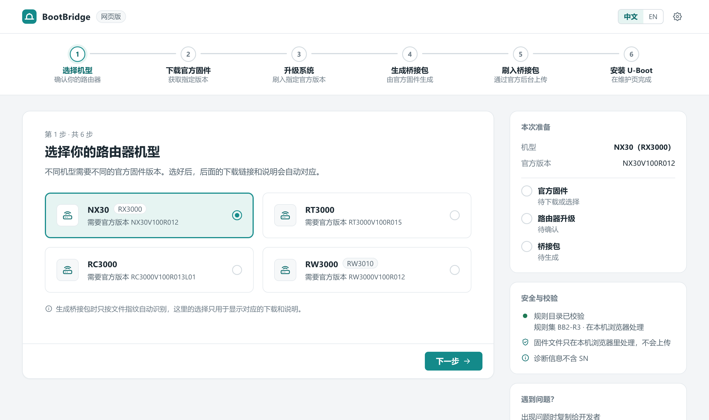
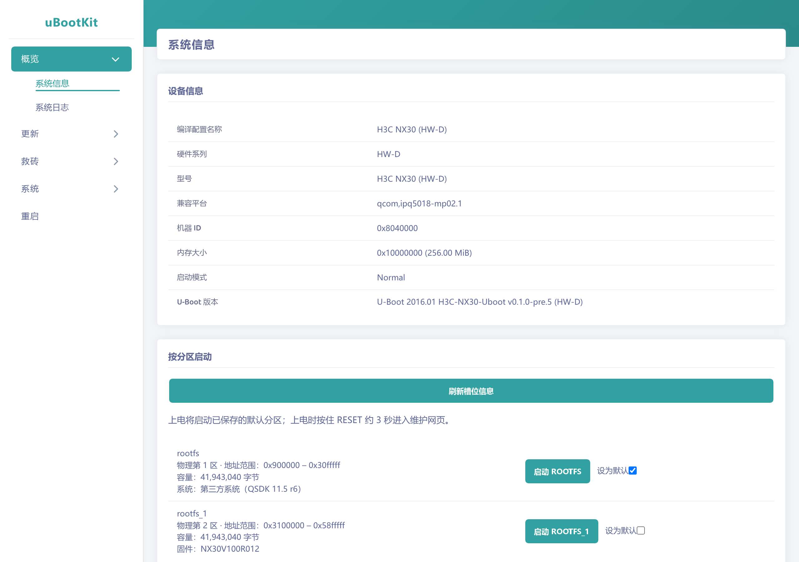

<div align="center">

# H3C-NX30-Uboot

**A U-Boot with web recovery and dual boot for the H3C NX30 / RT3000 / RC3000 / RW3000**

No disassembly, no serial cable: build a bridge package in your browser, upload it from the stock admin page, and follow the wizard. The stock firmware keeps working afterwards, and you can return to it at any time.

[](https://github.com/FlyFish-go/H3C-NX30-Uboot/releases/tag/uboot-v0.1.0-pre.6)
[](https://github.com/FlyFish-go/H3C-NX30-Uboot/releases/tag/bootbridge-v0.2.0-pre.3)
[](https://github.com/FlyFish-go/H3C-RT3000-Product-R1)
[](LICENSE)
[](https://github.com/FlyFish-go/H3C-NX30-Uboot/stargazers)

### [🚀 Open BootBridge Web and start installing](https://flyfish-go.github.io/H3C-NX30-Uboot/)

[Download U-Boot](https://github.com/FlyFish-go/H3C-NX30-Uboot/releases/tag/uboot-v0.1.0-pre.6) · [QSDK 11.5 firmware](https://github.com/FlyFish-go/H3C-RT3000-Product-R1) · [Supported devices](#supported-devices) · [Community](#community-and-feedback) · [简体中文](README.md)

</div>

<table>
<tr>
<td width="50%"></td>
<td width="50%"></td>
</tr>
<tr>
<td align="center">BootBridge Web: pick a model, get a bridge package</td>
<td align="center">Rescue page: boot either system or make it the default</td>
</tr>
</table>

## Features

- **🛟 Web recovery**: power off, hold Reset, power on, and open `192.168.10.1`. Flash firmware or U-Boot, back up the whole flash, restore ART / CDT / MIBIB, or boot an initramfs, all from the browser.
- **🔀 Dual boot**: the stock firmware and a third-party system each get a slot. Choose which one to boot and which one is the default. If you no longer need the stock firmware, merge both slots into one 80 MiB partition.
- **🧰 One-click install**: [BootBridge Web](https://flyfish-go.github.io/H3C-NX30-Uboot/) turns an official firmware file into a bridge package that you upload through the stock "firmware upgrade" page. Files are processed locally in your browser and never uploaded.
- **↩️ Way back**: the wizard takes a full backup before installing, and the bridge system can return to the stock firmware at any time, also by holding the Mesh/WPS button.
- **🔍 Hardware detection**: detects the board group (HW-A/B/C/D), NAND model and ECC, and installs only the matching build. The rescue page also refuses a mismatched U-Boot.
- **🔓 Open and reproducible**: sources, build scripts and a SHA-256 for every candidate are published.

## Supported devices

| Model | Required stock firmware | Board group | Tested on hardware |
|---|---|---|---|
| **NX30** / RX3000 | `NX30V100R012` | HW-D | ✅ NX30: full flow |
| **RT3000** | `RT3000V100R015` | HW-B or HW-C | ✅ one HW-B and one HW-C: full flow |
| **RC3000** | `RC3000V100R013L01` | HW-A | ✅ RC3000 (512 MB RAM): BootBridge install and return |
| **RW3000** / RW3010 | `RW3000V100R012` | HW-A | ✅ RW3000: U-Boot and QSDK firmware; BootBridge detection needs more reports |

One retail model can ship with different boards (the RT3000 exists as HW-B and HW-C). **You don't need to work this out yourself**; BootBridge reads the board and chooses. HW-A/B/C/D are this project's own groups, not H3C board names; see [hardware notes](docs/HARDWARE.md) (Chinese).

## Install in three steps

**Device still on stock firmware:**

1. Open [BootBridge Web](https://flyfish-go.github.io/H3C-NX30-Uboot/), choose your model, get the required official firmware and build the bridge package.
2. Upload the bridge package in the router's stock admin page under firmware upgrade. After the reboot, connect a cable to a **LAN** port and open `http://192.168.10.1`.
3. In the wizard: detect → back up → install. **Keep the backup on your own computer**; it contains the unit's calibration data and serial number. The router then reboots into the stock firmware as usual.

To reach the rescue page later: power off, hold Reset, power on, open `http://192.168.10.1`.

**Already running an older U-Boot from this project:** upload the new build on the rescue page under "U-Boot Update"; see the [pre.6 notes](releases/uboot-v0.1.0-pre.6.md) (Chinese; HW-D ECC8 units must use the RAM rescue build). Versions older than pre.3 follow the [pre.3 notes](releases/uboot-v0.1.0-pre.3.md) and need the firmware reflashed afterwards.

## Next: QSDK 11.5 firmware

The companion project [**H3C-RT3000-Product-R1**](https://github.com/FlyFish-go/H3C-RT3000-Product-R1) provides Qualcomm QSDK 11.5 / OpenWrt 21.02 firmware for all four board groups: NSS hardware offload with ~940 Mbps wired NAT, dual-band Wi-Fi 6, and calibration data read from the unit at boot. Write it to the non-stock slot from the rescue page and make that slot the default; the stock firmware stays untouched.

## Test status

One unit per board group has gone through the whole path from stock firmware to a third-party system:

| Board | BootBridge install and return | U-Boot pre.5 | 80 MiB partition | QSDK 11.5 r6 |
|---|:---:|:---:|:---:|:---:|
| HW-A (BootBridge on RC3000, the rest on RW3000) | ✅ | ✅ | ✅ | ✅ |
| HW-B (RT3000) | ✅ | ✅ | ✅ | ✅ |
| HW-C (RT3000 RTL8367S) | ✅ | ✅ | ✅ | ✅ |
| HW-D (NX30) | ✅ | ✅ | ✅ | ✅ |

All 84 U-Boot candidates (4 board groups × 21 NAND configurations) build and pass offline checks; the 4 above have run on hardware, the rest have not. pre.6 fixes the rescue page's firmware update and was tested on HW-A, HW-B and HW-D; HW-C has not been tested on pre.6 yet. Details in the [validation record](docs/VALIDATION.md) (Chinese).

## Before you start

> [!WARNING]
> This is still a **pre-release**. Rewriting the bootloader can brick a device; if you have no independent recovery (such as a serial console), consider waiting for more reports.

- Only the stock firmware versions listed above are accepted; BootBridge checks size and SHA-256.
- Do **not** upload the U-Boot partition file (`appsbl.mbn`) through the stock upgrade page. Use BootBridge for the first install.
- Devices flashed through the "Firmware Update" page of a rescue page older than pre.3 slowly develop ECC errors; upgrade U-Boot per the [pre.3 notes](releases/uboot-v0.1.0-pre.3.md) and reflash.
- If a BootBridge v0.1.0-pre.6 bridge left your device stuck in the bridge system, do not try other flashing methods; contact the maintainer.

## Community and feedback

- **QQ group: 1131957442** (questions, discussion and bug reports)
- [GitHub Issues](https://github.com/FlyFish-go/H3C-NX30-Uboot/issues): please use the [test report template](docs/TEST-REPORT-TEMPLATE.md) and include the version, image SHA-256 and logs with serial numbers removed.

**If this project saved you a serial cable, a ⭐ star helps other owners of these routers find it.**

## Building from source

```sh
git clone https://github.com/FlyFish-go/H3C-NX30-Uboot.git
cd H3C-NX30-Uboot
```

You need a compatible ARM toolchain; see [BUILDING](docs/BUILDING.md). Images you rebuild yourself need their own verification against their own digests.

## Acknowledgements

- [chenxin527/uboot-qsdk12.5-build](https://github.com/chenxin527/uboot-qsdk12.5-build) (uBootKit) and its upstream contributors: this U-Boot and its rescue page are built on it.
- [ayu1808](https://github.com/ayu1808): porting ideas and a great deal of testing.

## License

U-Boot and third-party components keep their original licenses and copyrights; new build and packaging code follows its own notices. See [LICENSE](LICENSE) and [LICENSE-NOTICE](LICENSE-NOTICE.md).

This project is not affiliated with H3C.

## Star History

[](https://star-history.com/#FlyFish-go/H3C-NX30-Uboot&FlyFish-go/H3C-RT3000-Product-R1&Date)
